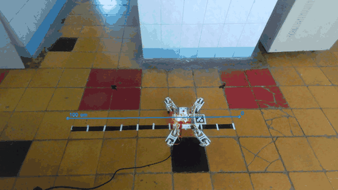
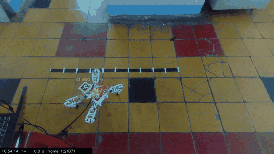
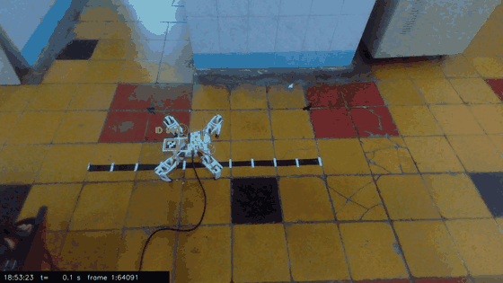
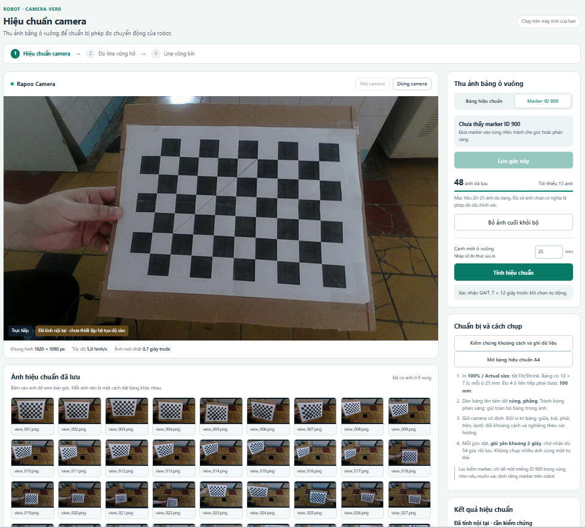
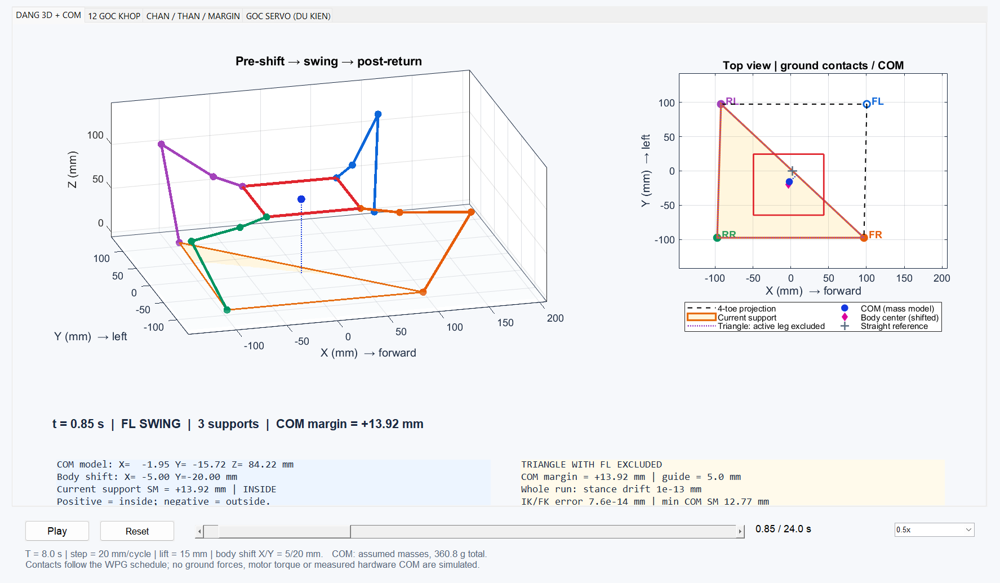
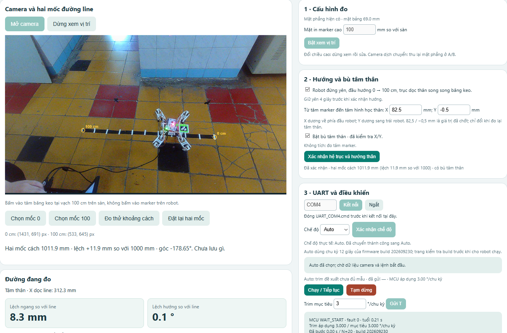
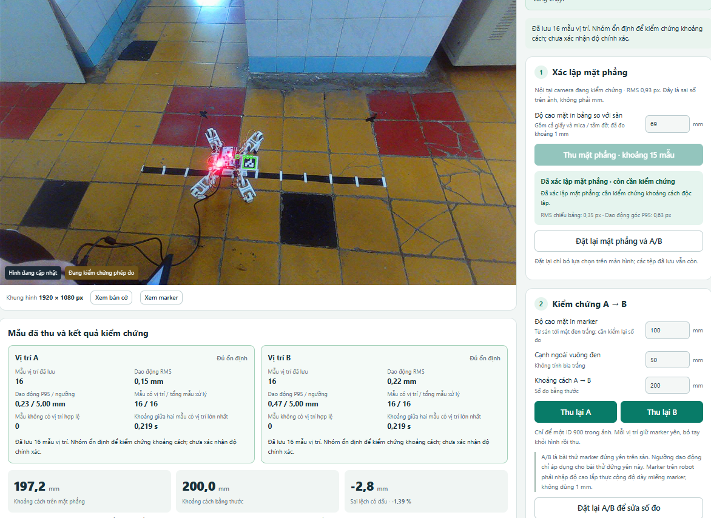

# Quadruped Robot with Camera-Based Trajectory Tracking

Design and control of a 12-servo quadruped robot that walks straight, turns in place, follows circles and figure-eight paths, and corrects its heading in closed loop using an external camera.

**Bachelor's thesis** – Control Engineering & Automation, Ho Chi Minh City University of Technology (HCMUT – VNU-HCM), 2026
**Author:** Hà Tất Thắng · **Advisor:** Prof. Dr. Hồ Phạm Huy Ánh

<p align="center">
  
  
  
</p>
<p align="center"><em>Left to right: closed-loop straight walking (camera feedback), circle walking (CCW), turning in place.</em></p>

---

## Highlights

- **Mechanical design**: custom quadruped body and 3-DOF legs (coxa–femur–tibia) designed in SolidWorks; 12 × MG90S servos.
- **Kinematics**: Denavit–Hartenberg model, closed-form forward and inverse kinematics, center-of-mass and static stability margin analysis.
- **Gait generation**: sequential (crawl) gait with body shifting before each leg lift, world-frame foot anchoring and swing trajectories. One shared motion framework is used for straight lines, in-place rotation, circles and Lissajous figure-eight paths.
- **Simulation**: MATLAB/Simulink models check FK/IK consistency, stance-foot drift, contact schedule, COM margin and servo commands before anything runs on hardware.
- **Embedded control**: the algorithm is ported to C on an STM32 NUCLEO-F446RE, which drives a PCA9685 16-channel PWM board over I²C.
- **Computer vision feedback** (Python + OpenCV):
  - intrinsic camera calibration from 48 chessboard images
  - floor-plane estimation and ArUco marker pose estimation (`solvePnP`, homography) to turn pixels into body position and heading in millimetres
  - a lateral-error / heading controller on the laptop sends trim corrections to the MCU over UART (framed protocol with sequence number, checksum and ACK)
  - a browser-based dashboard for calibration, measurement, logging and closed-loop runs

## System overview

```
 ┌──────────────┐  USB video   ┌──────────────────────────────┐   UART 115200   ┌────────────────────┐   I²C   ┌──────────┐
 │  USB camera  │ ───────────▶ │ Laptop (Python / OpenCV)     │ ─────────────▶ │ NUCLEO-F446RE      │ ──────▶ │ PCA9685  │──▶ 12 × MG90S
 │  (external)  │              │ calibration · ArUco pose ·   │  trim commands  │ gait generator ·   │         │ 50 Hz PWM│
 └──────────────┘              │ line advisor · dashboard     │ ◀───────────── │ IK · servo mapping │         └──────────┘
                               └──────────────────────────────┘    telemetry    └────────────────────┘
```

## Results

| Task | Hardware result |
|---|---|
| Straight walking, open loop | Works; fixed heading trim reduces drift, but the result depends on the trim value and the error still accumulates |
| Straight walking, closed loop (camera) | In 5 runs, the average lateral offset went from +10.0 mm at the start to −4.2 mm at cycle 20 |
| Turning in place | Works in both directions |
| Circle | Works CW and CCW; the CW run finished closer to the start point |
| Figure eight | Switches turning direction between the loops, but the full path is **not yet** reproduced reliably |

Camera measurement check: a 200.0 mm reference was measured as 197.2 mm (−1.39 %), with RMS noise of 0.15–0.22 mm at a fixed position.

See [`docs/thesis_report_vi.pdf`](docs/thesis_report_vi.pdf) (Vietnamese) for the full derivation, experiments and limitations.

<p align="center">
  
  
</p>

## Dashboard

All camera work is done from a local web dashboard served by the Python program. It handles floor-plane setup, A→B distance checks, line reference selection, UART connection, Auto/Manual mode and live logging.

<p align="center">
  
</p>
<p align="center"><em>Closed-loop run: live camera view with ArUco marker and line reference, measured lateral/heading error, and UART control panel.</em></p>

<p align="center">
  
</p>
<p align="center"><em>Measurement validation: 16 samples at each of positions A and B, RMS noise 0.15 / 0.22 mm, A→B distance 197.2 mm vs. 200.0 mm ruler (−1.39 %).</em></p>

## Repository structure

```
firmware/   STM32 main.c variants (one per motion mode) + PCA9685 driver
matlab/     FK/IK scripts, parameters and Simulink models (line, rotate, circle, figure-eight)
vision/     Python camera measurement, calibration, line/circle tracking, closed-loop control, web UI
cad/        STEP files of the robot body and legs
docs/       Thesis report (Vietnamese)
media/      GIFs and figures
```

## Getting started

### Firmware (STM32CubeIDE)
1. Create a CubeIDE project for NUCLEO-F446RE with I²C1 (100 kHz) and USART2 (115200 8N1) enabled.
2. Add `pca9685.c` / `pca9685.h`.
3. Copy **one** of the `main_*.c` files into `Core/Src/main.c`, depending on the motion you want:

| File | Motion |
|---|---|
| `main_walk_straight.c` | Stand and walk straight with heading trim |
| `main_rotate.c` | Turn in place, left or right |
| `main_circle.c` | Circle, CW or CCW |
| `main_figure8.c` | Lissajous figure-eight |
| `main_uart_closed_loop.c` | Straight walking that receives trim over UART (used together with `vision/`) |

Parameters such as step length, period and lift height are `#define`s at the top of each file.

### Simulation (MATLAB R2024a + Simulink)
See [`matlab/README.md`](matlab/README.md). Open MATLAB inside the `matlab/` folder and run one of the snippets.

### Vision (Python 3)
```bash
pip install -r requirements.txt
cd vision
python camera_ver0.py
```
This starts a local dashboard at `http://127.0.0.1:<port>`. Calibration, plane setup, measurement and closed-loop runs are all done from that page. Windows only: the serial link uses the Win32 API.

## Tech stack

`C` · `STM32 HAL` · `I²C` · `UART` · `MATLAB/Simulink` · `Python` · `OpenCV (ArUco, calibration, PnP)` · `NumPy` · `SolidWorks`

## Notes

- Code comments and the thesis are written in Vietnamese.
- The figure-generation script `circle_figure.py` depends on a helper module that is not included.
